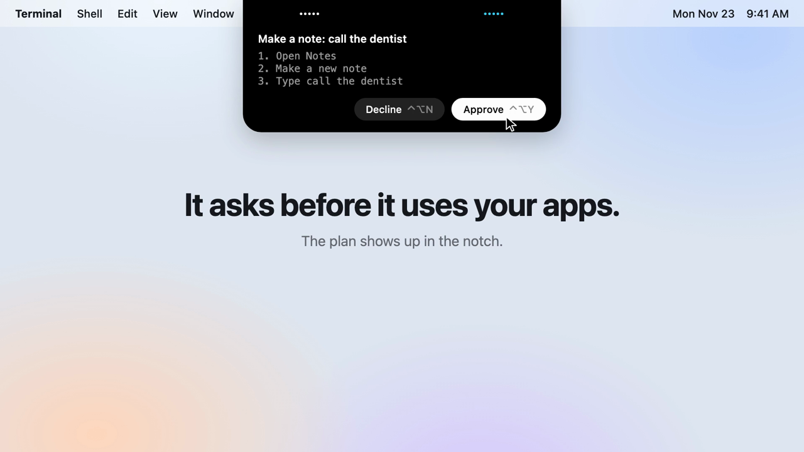

# milo

milo is a voice assistant that runs entirely on your Mac. You talk, and it talks
back, like a phone call. It starts preparing an answer before you finish
speaking, you can talk over it to interrupt, and it makes small listening
sounds, such as "mm-hmm," while you talk. It can also check the weather, set
timers, open apps, use apps for you, and remember what you tell it.

[](docs/demo.mp4)

To see what milo does, watch the [one-minute demo video](docs/demo.mp4).

## Requirements

- A Mac with Apple silicon, macOS 14 or later, and 32 GB of memory or more
- Xcode 26, or the Xcode Command Line Tools with Swift 6.2 or later
- About 20 GB of free disk space for the models

## Get started

1.  Clone the repository and run the setup script:

    ```sh
    git clone https://github.com/govindpuff/milo
    cd milo
    ./setup.sh
    ```

    The script installs Rust, uv, and the Rapid-MLX model server if they're
    missing, and then builds and installs the `milo` command. You can run it
    again at any time.

2.  Start milo:

    ```sh
    milo
    ```

    The first start downloads about 18 GB of models, which can take several
    minutes. When macOS asks whether your terminal can use the microphone,
    allow access.

3.  When milo prints `listening`, start talking.

If you use headphones, start milo with `milo --no-aec`. This turns off echo
cancellation, and milo stops talking as soon as it hears your voice.

To quit, press Control+C.

## Things to try

- "What's the weather in Chicago?"
- "Set a timer for two minutes."
- "Open Safari."
- "Make a new note that says call the dentist."
- "Pause that video."
- "Close the YouTube tab."
- "Write a hello world Python file on my desktop, and open it in VS Code."
- "Remember that my sister's name is Priya."
- Talk over milo to interrupt it.
- Pause in the middle of a sentence. milo waits for you to go on.

## Approve actions

milo shows a small panel in the notch at the top of your screen. On a Mac
without a notch, the panel sits at the top center of the screen. The bars on
the left move with your voice, and the bars on the right move with milo's. To
see what milo is doing, hold the pointer over the panel.

To mute your microphone, hold the pointer over the panel and click the
microphone button. To unmute, click the button again.

Before milo opens an app or a website, closes a browser tab, writes a file, or
runs one of your own tools, the panel shows exactly what it is about to do. To let it run, click **Approve**. To stop it, click
**Decline**. If you don't answer within 45 seconds, milo doesn't run the
command.

You can keep talking while a command waits. If you ask for something else, the
panel shows the newest command first, and the older ones wait behind it. If you
correct a plan before you approve it, the new plan replaces the old one.

milo pauses, resumes, and skips a video or music without asking, and it
switches to a browser tab without asking.

The following keyboard shortcuts work in any app:

| Shortcut | Action |
|---|---|
| Control+Option+Y | Approves the command in the panel. |
| Control+Option+N | Declines the command in the panel. |
| Control+Option+M | Mutes or unmutes your microphone. |
| Control+Option+Space | Unmutes your microphone while you hold the keys, and mutes it when you release them. |

To use milo like a walkie-talkie, start it with `milo --push-to-talk`. Your
microphone starts muted, and milo hears you only while you hold
Control+Option+Space.

To turn off the panel, start milo with `milo --no-notch`. milo then runs
commands without asking, and can't use apps for you.

## Let milo use your apps

milo can click, type, press keys, and choose menu items in the apps on your
Mac. For example, you can ask it to write a note, send a message, or search a
website.

1.  In System Settings, go to **Privacy & Security**, and turn on access for
    your terminal app under both **Accessibility** and **Screen Recording**.
2.  In Chrome, go to `chrome://inspect/#remote-debugging`, and turn on
    **Allow remote debugging for this browser instance**. You do this once.
3.  Start milo again. Chrome comes to the front and asks whether to allow
    remote debugging. Click **Allow**. Chrome asks this each time that milo
    starts.
4.  Ask milo for something that takes a few steps in an app or on a website.
5.  The panel shows the plan as a list of steps. To let milo carry out the
    whole plan, click **Approve**, or press Control+Option+Y. milo doesn't ask
    again for each step.
6.  While milo works, the panel shows the last thing that it did. To stop it,
    click **Stop**, press Control+Option+N, or tell milo to stop.

When milo finishes, it tells you what it did. milo works on one plan at a time,
and stops a plan that takes longer than six minutes.

### Quick actions

For some requests, milo doesn't click through a window at all:

- **Video and music.** milo pauses or resumes what is playing in a browser tab
  through the browser connection. For music in an app, it presses the play
  key or a track key.
- **Tabs.** milo closes a tab or switches to it by a word from its title.
- **Files.** milo writes the text of a file itself, under your home folder,
  and can open the file in an app. The panel shows the path and the text
  first. milo doesn't run the file.

### Websites

milo reads a web page and uses its buttons, links, and fields through Chrome's
remote debugging connection. This also works in Brave, Edge, Arc, Vivaldi, and
Chromium.

- milo opens websites in a browser window of its own, behind your other
  windows, and leaves your tabs as they are.
- milo can also work in a tab that you already have open. For example, you can
  ask it to pause the video that is playing, or to close a tab.
- milo remembers where it worked last. You can ask for one thing, and then
  for the next thing on the same page.
- When you ask to see something, milo brings its tab to the front when it
  finishes. Otherwise, your screen stays as it is.

If remote debugging is off, or you use another browser, milo reads the browser
window off the screen instead. This is slower and less exact.

### Apps

In an app, milo looks at a picture of the window, and reads the names of its
buttons, fields, and text. milo brings the app to the front while it works
there, and puts your app back when the plan finishes.

milo starts each plan in the place where it worked last, or goes to the app or
the tab that the plan names. It never works in the terminal window that milo
runs in unless you ask for that app by name.

If something asks milo to allow, confirm, sign in, pay, delete, or send
something that the plan doesn't cover, milo stops and tells you what it asks.
milo can't see a window that is minimized.

In a save or open dialog, milo can type the file name and choose a folder from
the **Where** menu. It can't go to a folder that the menu doesn't list.

You can also ask milo what is on your screen. It looks at the window or the
tab in front, without asking for approval.

To run one task without the voice, use `--task`, and give each step of the
plan with `--step`:

```sh
milo --task "Search YouTube for cats" --step "Open youtube.com" --step "Search for cats"
```

milo prints each action and the result, and then exits. This runs the plan
without asking for approval.

## Memory

milo saves lasting facts that you mention, such as your name or where you live,
in `~/.config/milo/memory.md`, one fact per line. To remove a fact, ask milo to
forget it, or edit the file.

## Add your own tools

To let milo run your own commands, list them in `~/.config/milo/tools.json`:

```json
[
  {
    "name": "lights",
    "description": "Turn the lights on or off.",
    "parameters": {
      "type": "object",
      "properties": {
        "state": { "type": "string", "enum": ["on", "off"] }
      },
      "required": ["state"]
    },
    "run": ["shortcuts", "run", "Lights {state}"]
  }
]
```

- `name`: the tool name, in letters, digits, and underscores.
- `description`: what the tool does. milo reads this text to decide when to use
  the tool.
- `parameters`: optional. A [JSON Schema](https://json-schema.org) object that
  describes the values that milo fills in.
- `run`: the command and its arguments. milo replaces each parameter name in
  braces, such as `{state}`, with its value.

milo asks for your approval in the notch panel, runs the command without a
shell, and stops it after 20 seconds. Whatever
the command prints is the result that milo tells you.

**Caution:** The language model fills in the parameter values. Only add
commands that are safe to run with any value.

## Change the voice

To get a different voice, describe it:

```sh
milo --voice-design "A calm British woman with a low, slow, thoughtful voice."
```

To copy a voice, give a WAV recording of 3 to 12 seconds and the exact words
that it contains.

```sh
milo --voice-ref RECORDING.wav --voice-text "The exact words in the recording."
```

## Change the model

To use another model, pass any model name that Rapid-MLX can serve. For
example, the following model is smaller and runs on a Mac with 18 GB of memory:

```sh
milo --model qwen3.5-9b-4bit
```

To use your own OpenAI-compatible server instead of Rapid-MLX, give its base
URL and the model name that it expects:

```sh
milo --llm-url http://127.0.0.1:1234/v1 --model MODEL_NAME
```

The server must stream chat completions and must not require an API key. If it
doesn't support tool calls, add `--no-tools`.

## Options

| Option | Description |
|---|---|
| `--model` | The language model. The default is `gemma-4-26b-qat-4bit`. |
| `--llm-url` | The base URL of your own OpenAI-compatible server. |
| `--port` | The port for the model server. The default is `8000`. |
| `--system-prompt` | A file with your own system prompt, which replaces the built-in one. |
| `--voice-design` | A description of the voice to create. |
| `--voice-ref`, `--voice-text` | A WAV recording of a voice to copy, and its exact transcript. |
| `--tts` | The voice engine: `breeze` (the default), or `phonon`, which is smaller and faster but less natural. |
| `--tts-port` | The port for the voice. The default is `8881`. |
| `--no-aec` | Turns off echo cancellation. Use it with headphones. |
| `--push-to-talk` | Starts with your microphone muted. To talk, hold Control+Option+Space. |
| `--no-notch` | Turns off the panel in the notch. milo then runs commands without asking. |
| `--no-tools` | Turns off tools and memory. |
| `--no-backchannel` | Turns off the listening sounds while you talk. |
| `--nudge-ms` | How long milo waits in silence before it follows up, in milliseconds. The default is `6000`. To turn off follow-ups, set it to `0`. |
| `--input-device`, `--output-device` | The microphone or the speakers, by name. |
| `--list-devices` | Lists the audio devices and exits. |
| `--task`, `--step` | Carries out one task in your apps without the voice, and exits. Repeat `--step` for each step of the plan. |

## Troubleshooting

- **milo doesn't hear you.** In System Settings, go to **Privacy & Security** >
  **Microphone**, turn on access for your terminal app, and start milo again.
  To choose a microphone, run `milo --list-devices`, and then pass a name to
  `--input-device`.
- **The voice sounds different or flat.** The main voice couldn't start, and
  milo is using its built-in fallback. The log line that mentions Phonon gives
  the reason. Run `./setup.sh` again.
- **The build fails with a Rust version error.** Run `rustup update`, and then
  run `./setup.sh` again.
- **milo says that Accessibility or Screen Recording is turned off.** In System
  Settings, go to **Privacy & Security**, turn on access for your terminal app
  under **Accessibility** and **Screen Recording**, and start milo again.
- **milo says that no browser allows remote debugging.** In Chrome, go to
  `chrome://inspect/#remote-debugging`, turn on **Allow remote debugging for
  this browser instance**, and start milo again.
- **milo does the wrong thing in an app.** The folder `$TMPDIR/milo-computer`
  has the picture and the list that milo saw at each step of the last plan,
  and the action that led to it.
- **Something else is wrong.** Run `RUST_LOG=debug milo` for more detail. The
  model server and the voice write their own logs to
  `$TMPDIR/milo-rapid-mlx-8000.log` and `$TMPDIR/milo-voice-8881.log`.

## Uninstall

```sh
cargo uninstall milo
rm -rf ~/.cache/milo ~/.config/milo
```

The models stay in `~/.cache/huggingface/hub` and
`~/Library/Application Support/FluidAudio/Models` until you delete them.

## How it works

```text
microphone -> speech recognition -> turn detection -> model -> voice -> speakers
```

For the details, see [milo architecture](docs/architecture.md).

## License

milo is licensed under the [MIT License](LICENSE). The models that milo
downloads have their own licenses.
